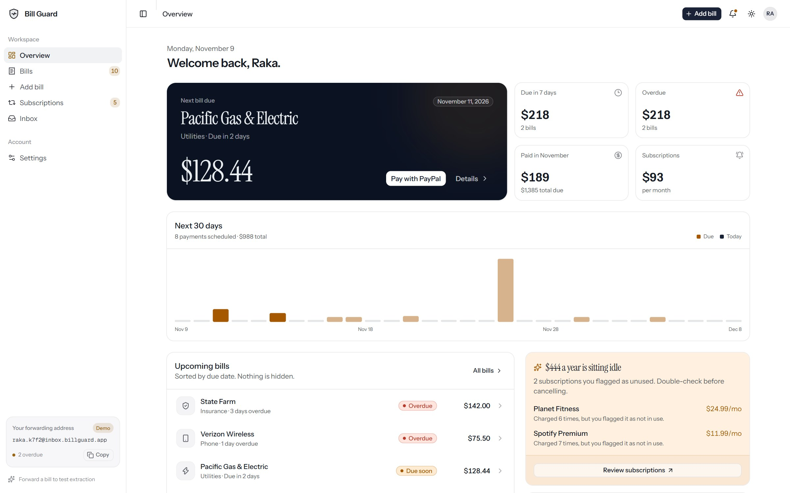
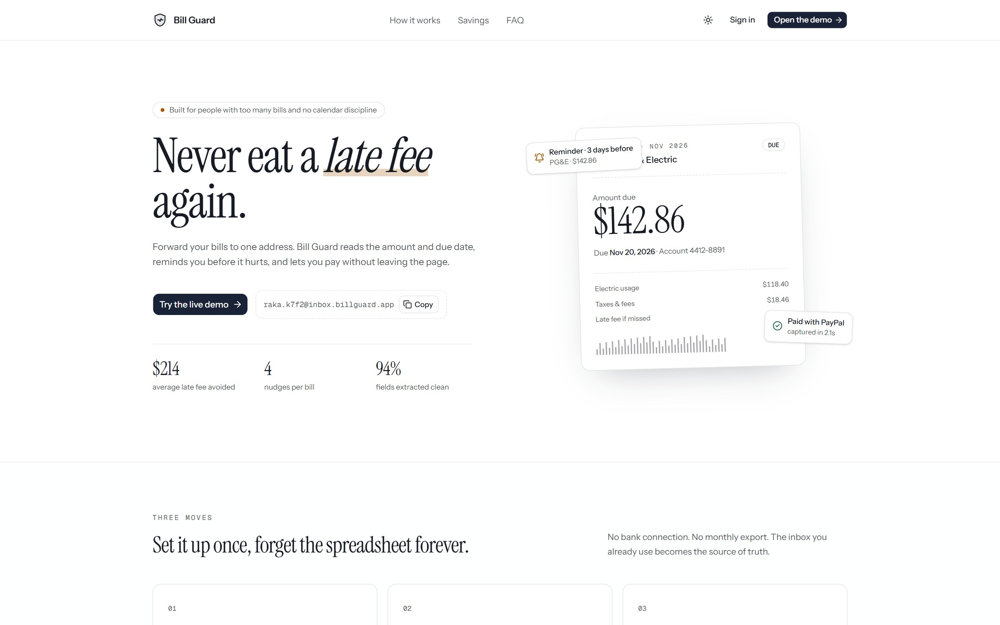
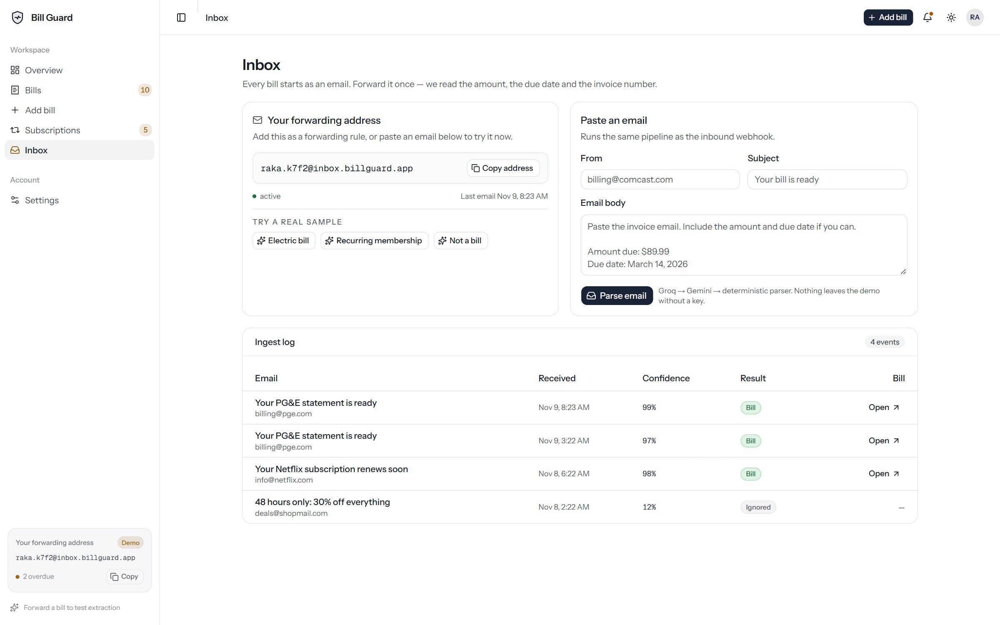
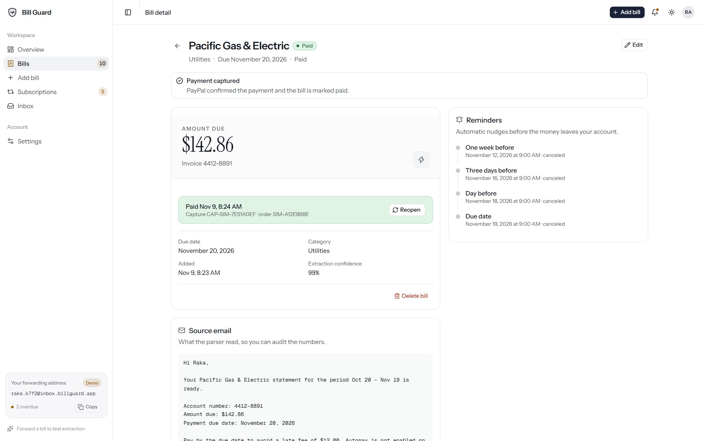
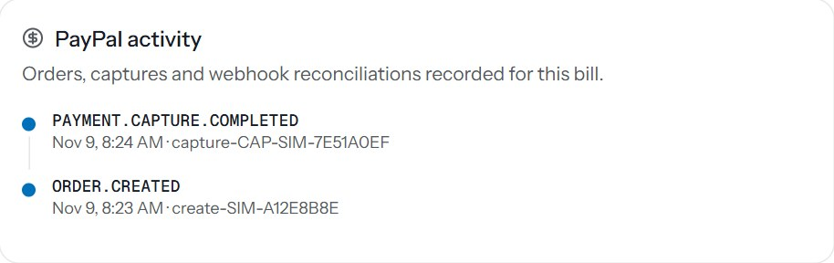
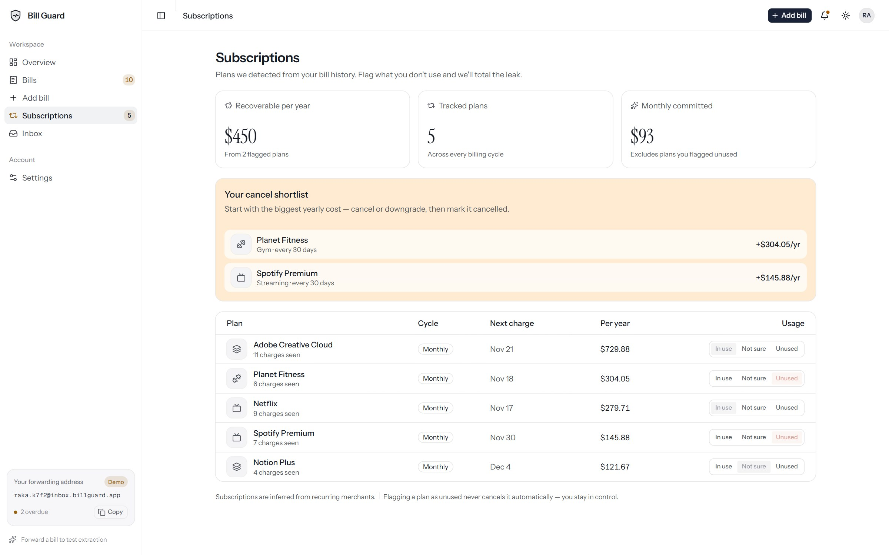
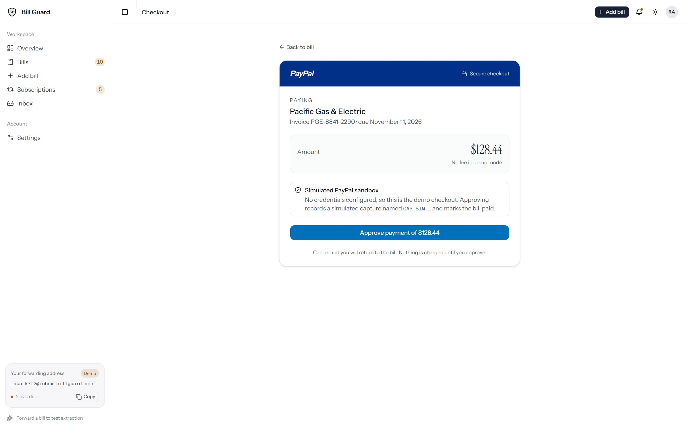
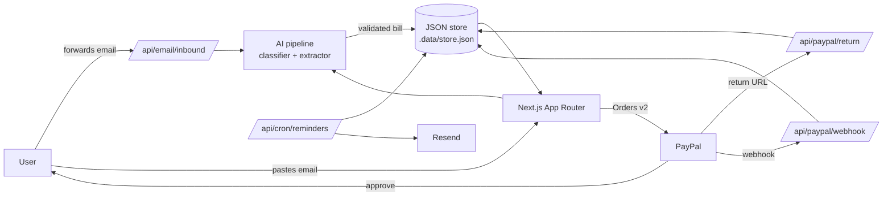

# Deadline Bill Guard

**Forward a bill. Get reminded. Pay with PayPal.**

Deadline Bill Guard turns forwarded bill emails into structured, payable bills, schedules a reminder ladder before each due date, and settles the payment through PayPal Orders v2 with a verified webhook audit trail.

Built for the **"Build What's Next with PayPal and AI"** hackathon.

**Live demo:** <https://deadline-bill-guard.vercel.app> — open the app, click **Enter the demo**, no signup or credentials needed.

[](https://nextjs.org)
[](https://react.dev)
[](https://www.typescriptlang.org)
[](https://tailwindcss.com)
[](https://developer.paypal.com/api/rest/)
[](src/lib/ai)
[](LICENSE)

[](docs/screenshots/02-dashboard.jpg)

## Contents

- [The problem](#the-problem)
- [What it does](#what-it-does)
- [Screenshots](#screenshots)
- [Judge quickstart](#judge-quickstart-2-minutes)
- [How it works](#how-it-works)
- [AI extraction pipeline](#ai-extraction-pipeline)
- [Reminders](#reminders)
- [PayPal checkout](#paypal-checkout)
- [Subscriptions and insights](#subscriptions-and-insights)
- [Data model](#data-model)
- [Tech stack](#tech-stack)
- [Getting started](#getting-started)
- [Environment variables](#environment-variables)
- [Scripts](#scripts)
- [API routes](#api-routes)
- [Project structure](#project-structure)
- [Testing](#testing)
- [Demo video pipeline](#demo-video-pipeline)
- [Deployment](#deployment)
- [Security and privacy](#security-and-privacy)
- [Design decisions](#design-decisions)
- [Limitations and roadmap](#limitations-and-roadmap)
- [Hackathon tools](#hackathon-tools)
- [License](#license)

## The problem

People do not miss bills because they are careless. Bills arrive as email, get buried under newsletters, and the late fee is the notification. Meanwhile subscriptions renew silently, and the only place that knows about all of them is an inbox nobody wants to audit.

Deadline Bill Guard treats the inbox you already use as the source of truth. No bank credentials, no screen scraping, no spreadsheet, no calendar entry you will forget to make.

**The loop:** forward an email → AI extracts the bill → reminders fire before the deadline → one PayPal click settles it → the bill keeps a payment audit trail.

## What it does

- **Email-to-bill ingestion** — forward an email to the per-user inbound address, or paste it directly in the app. Both paths run the same pipeline, and duplicates are detected by `Message-ID`.
- **Two-stage AI extraction** — a classifier decides whether the message is actually a bill; an extractor returns structured fields. Zod validates the response, a deterministic parser cross-checks it, and a confidence score decides whether to auto-create a bill or leave it for review.
- **Reminder ladder** — four reminders per pending bill (7, 3, 1, and 0 days before the due date), scheduled in the user's timezone and delivered by a cron endpoint through Resend.
- **PayPal checkout** — Orders v2 create, buyer approval, capture on return, webhook signature verification, and a per-bill PayPal activity log.
- **Subscription radar** — recurring merchants are grouped so forgotten plans become one honest yearly number.
- **Dashboard insights** — due soon, overdue, monthly recurring spend, and a next-30-days cash view.
- **CSV export** — every bill, one click, no lock-in.
- **Demo mode** — with no credentials at all, the app still runs end to end: simulated PayPal ids, logged emails, deterministic AI fallback, seeded local data.

Supported currencies: **USD, EUR, GBP, IDR, SGD, INR, PHP, AUD, CAD, MYR, THB, BRL, MXN**.

## Screenshots

| Landing | Inbox |
| --- | --- |
| [](docs/screenshots/01-landing.jpg) | [](docs/screenshots/03-inbox.jpg) |
| **Bill detail** | **PayPal activity** |
| [](docs/screenshots/04-bill.jpg) | [](docs/screenshots/05-paypal-activity.jpg) |
| **Subscriptions** | **Checkout** |
| [](docs/screenshots/06-subscriptions.jpg) | [](docs/screenshots/07-checkout.jpg) |

## Judge quickstart (2 minutes)

Requirements: **Node.js 20+** and npm. No API keys, no database, no PayPal account.

```bash
git clone https://github.com/Dikaaff/DeadlineBillGuard.git
cd DeadlineBillGuard
npm install
npm run dev
```

Open <http://localhost:3000>, then:

1. Click **Open the demo** → **Enter the demo**. Twelve bills, five subscriptions, and seeded ingest history are already loaded.
2. **Inbox** → run a sample email → open the new bill. The classifier, extractor, and confidence score are recorded in the ingest log.
3. **Pay with PayPal** → **Approve payment**. Without PayPal credentials the flow is simulated (`SIM-` / `CAP-SIM-` ids) but every state transition is real.
4. Open the **PayPal activity** card: order created, capture completed, and the synthetic reconciliation event are listed.
5. **Subscriptions** → flag a plan as unused → the yearly total updates.
6. **Settings** → **Download CSV**.

Local data lives in `.data/store.json` and is git-ignored.

## How it works



1. **Ingest** — an email arrives via the inbound endpoint or the paste form. HTML is stripped, whitespace is compacted, and the text is truncated to a safe prompt size.
2. **Classify** — the LLM answers one question: is this an unpaid bill, invoice, or subscription charge? Promotions are ignored and logged.
3. **Extract** — the second pass returns merchant, amount, currency, due date, invoice id, category, and a subscription hint as JSON.
4. **Validate** — Zod rejects malformed shapes; guardrails bound the amount and due date; the deterministic heuristic parser supplies a second opinion.
5. **Decide** — at `confidence >= 0.6` with a positive amount and a due date, a bill and its reminder ladder are created. Everything else is logged as `ignored` or `uncertain`.
6. **Remind** — the cron endpoint sends H-7, H-3, H-1, and H-0 reminders for bills that are still pending.
7. **Pay** — PayPal creates an order tagged with the bill id, the buyer approves, the return handler captures it, and a signature-verified webhook reconciles the capture.
8. **Audit** — the bill keeps the source snippet, extraction metadata, reminder history, and every PayPal event.

## AI extraction pipeline

`src/lib/ai/` implements a deliberately boring, auditable pipeline:

```text
forwarded email
      │
      ▼
sanitize + truncate
      │
      ▼
┌─────────────────────┐      not a bill
│ classifier (LLM)    ├──────────────────► ignored (logged)
└─────────┬───────────┘
          │ is_bill
          ▼
┌─────────────────────┐
│ extractor (LLM)     │  merchant, amount_cents, currency,
└─────────┬───────────┘  due_date, invoice_id, category, confidence
          │
          ▼
┌─────────────────────┐
│ Zod validation      │  reject malformed JSON / wrong types
├─────────────────────┤
│ guardrails          │  amount bounds, date window, whitelists
├─────────────────────┤
│ heuristic crosscheck│  deterministic regex/date parser as a second opinion
└─────────┬───────────┘
          │
    confidence >= 0.6 ?
     yes ──► create bill + reminder ladder
      no ──► logged as uncertain for human review
```

**Providers**

| Role | Provider | Model | Notes |
| --- | --- | --- | --- |
| Primary | Groq | `llama-3.3-70b-versatile` | JSON mode, 12s timeout |
| Fallback | Google Gemini | `gemini-2.0-flash` | Used when Groq is unavailable or returns unusable JSON |
| Last resort | Deterministic heuristic | — | Always available, including with zero API keys |

Prompts are versioned in [`src/lib/ai/prompts.ts`](src/lib/ai/prompts.ts) (classifier `v1.2`, extractor `v2.1`, subscription insight `v1.0`) with an eval target recorded beside each one.

**Guardrails**

| Check | Rule | Effect |
| --- | --- | --- |
| Amount | `$0.01` – `$100,000.00` | Out-of-range amount is dropped, confidence `−0.2` |
| Due date | `−90` to `+400` days from today | Out-of-window date is dropped, confidence `−0.2` |
| Missing due date | Bill without a date | Confidence `−0.2` |
| Currency | 13-currency whitelist | Falls back to `USD`, confidence `−0.1` |
| Category | 11-category whitelist | Falls back to `other` |
| Cross-check | LLM vs heuristic agreement | Disagreement lowers the score |
| Threshold | `confidence >= 0.6` | Below it, no bill is created |

Every ingest stores `method`, `provider`, `model`, `latency_ms`, `confidence`, and raw signals, so each auto-created bill can be explained after the fact.

## Reminders

Each pending bill gets a four-step ladder, anchored to the due date at the user's configured send hour (default `09:00`) in the user's timezone.

| Offset | Intent | Label in the UI |
| --- | --- | --- |
| H-7 | One week to plan cash flow | `Sent` / scheduled |
| H-3 | Mid-week nudge | `Sent` / scheduled |
| H-1 | Tomorrow | `Sent` / scheduled |
| H-0 | Due today | `Sent` / scheduled |

- The cron handler at `GET`/`POST /api/cron/reminders` is idempotent: a reminder is marked sent once it has been handled, whether delivered, skipped, or failed.
- Paid and cancelled bills have their remaining reminders marked `canceled`; the bill detail page shows this instead of a misleading `sent`.
- Reminders pause when the user disables them in **Settings**.
- Delivery uses Resend when `RESEND_API_KEY` is set. Otherwise it writes to the server console, which keeps the local demo fully functional.
- With Resend configured, addresses ending in `@billguard.app` (the seeded demo user) are logged rather than emailed, so demo runs never send real mail.

## PayPal checkout

`src/lib/paypal.ts` and the routes under `src/app/api/paypal/` implement the full Orders v2 flow. PayPal is not bolted on as a button: the bill id travels with the order, and the payment lifecycle is reconciled back onto the bill.

| Step | Implementation |
| --- | --- |
| Authenticate | OAuth 2.0 client credentials; token cached in memory until 30s before expiry |
| Create order | `POST /v2/checkout/orders` with `intent: CAPTURE`, `reference_id` and `custom_id` set to the bill id |
| Idempotency | `PayPal-Request-Id` on both order creation and capture |
| Approve | The buyer is redirected to PayPal's `approve` link from `/app/checkout/[orderId]` |
| Capture | `POST /v2/checkout/orders/{id}/capture` on `/api/paypal/return` |
| Webhook | `POST /v1/notifications/verify-webhook-signature`, then reconcile `PAYMENT.CAPTURE.COMPLETED` |
| Audit | `ORDER.CREATED`, `PAYMENT.CAPTURE.COMPLETED`, and the webhook reconciliation event are shown on the bill |

Without `PAYPAL_CLIENT_ID` / `PAYPAL_CLIENT_SECRET` the same code paths run in **demo mode**: orders get `SIM-*` ids, captures get `CAP-SIM-*` ids, and the checkout page says the payment is simulated. Nothing silently pretends to be a live charge.

See [`docs/PAYPAL_SANDBOX.md`](docs/PAYPAL_SANDBOX.md) for real sandbox credentials, webhook registration, and the full capture walkthrough.

## Subscriptions and insights

- Bills marked as subscription candidates are grouped by merchant into the **Subscriptions** view.
- Each plan shows monthly cost, yearly cost, next charge, usage state, and whether it is a cancellation candidate.
- Flagging a plan as unused updates the recoverable yearly total.
- The dashboard combines due-soon, overdue, and recurring-spend insights so the first screen answers three questions: what is due, what is late, and what is quietly leaving every month.

## Data model

All entities live in one JSON database. Locally it is a file (`.data/store.json`, override with `DBG_DATA_DIR`); when `BLOB_READ_WRITE_TOKEN` is set the same document is stored in a private Vercel Blob store so every serverless instance sees the same data.

| Entity | Purpose |
| --- | --- |
| `User` | Demo account, email, timezone, reminder preferences, inbound address |
| `Bill` | Merchant, amount, currency, due date, invoice id, category, status, source snippet, extraction metadata |
| `Reminder` | One row per offset (`7`, `3`, `1`, `0`) with scheduled time and delivery state |
| `Subscription` | Recurring merchant, plan, monthly cost, usage state, next charge |
| `IngestLog` | Every inbound email and its outcome (`bill`, `ignored`, `uncertain`, `duplicate`) |
| `PaypalEvent` | Order, capture, and webhook events keyed by PayPal ids and bill id |

File writes are serialized through an in-process queue and committed with a temp-file + rename, with retries for the Windows file-locking edge cases. Blob writes refresh a short-lived per-instance read cache. The store is intentionally swappable: every access goes through `src/lib/db/store.ts`, so a Postgres adapter can replace it without touching the UI or routes.

Seeded demo state: **12 bills**, **5 subscriptions**, one demo user (`you@billguard.app`, timezone `America/Los_Angeles`).

## Tech stack

| Area | Choice |
| --- | --- |
| Framework | Next.js 16.4.3 (App Router, Turbopack, standalone output) |
| Language | TypeScript 5 |
| UI | React 19.3, Tailwind CSS v4, shadcn-style components on Radix primitives |
| Icons / motion | `lucide-react`, `tw-animate-css` |
| Charts | Recharts |
| Dates | `date-fns`, `react-day-picker` |
| Validation | Zod 4 |
| AI | Groq (primary), Google Gemini (fallback), deterministic heuristics |
| Payments | PayPal Orders v2 + Webhooks |
| Email | Resend (console fallback) |
| Storage | JSON store: local file, or private Vercel Blob in production |
| Tests | Playwright |

> This project pins Next.js **16.4.3**. That release line has breaking changes versus older App Router versions — read `node_modules/next/dist/docs/` before changing routing or config code.

## Getting started

**Prerequisites:** Node.js 20+ and npm.

```bash
# 1. Install dependencies
npm install

# 2. Create your local env file (optional; everything has a working default)
cp .env.example .env.local
# Windows PowerShell: Copy-Item .env.example .env.local

# 3. Start the development server
npm run dev
```

Open <http://localhost:3000> and click **Open the demo**. Nothing is required to run locally:

- AI falls back to the deterministic parser when no provider key is set.
- PayPal runs in simulated mode when no client id/secret is set.
- Email is logged instead of sent when `RESEND_API_KEY` is absent.
- Data is written to `.data/`.

To reset the demo, stop the server and delete `.data/` (or call the store's `reset()`), then start again.

### Production build

The app uses `output: "standalone"`, so the production entry point is the generated server, not `next start`:

```bash
npm run build

# Copy static assets into the standalone bundle
cp -r .next/static .next/standalone/.next/
cp -r public .next/standalone/

PORT=3000 DBG_DATA_DIR=./data node .next/standalone/server.js
```

On Windows PowerShell:

```powershell
npm run build
Copy-Item -Recurse -Force .next\static .next\standalone\.next\static
Copy-Item -Recurse -Force public .next\standalone\public
$env:PORT=3000; $env:DBG_DATA_DIR="./data"; node .next\standalone\server.js
```

## Environment variables

Copy `.env.example` to `.env.local` (or `.env` in Docker). Nothing is required for local development, but production needs `AUTH_SECRET` and a persistent data directory.

| Variable | Default | Purpose |
| --- | --- | --- |
| `AUTH_SECRET` | dev fallback | Session signing secret. Generate with `openssl rand -base64 32`. **Required in production.** |
| `NEXT_PUBLIC_APP_URL` | `http://localhost:3000` | Public base URL used in links, PayPal return URLs, and emails. |
| `NODE_ENV` | `development` | Standard Node environment flag. |
| `VERCEL_URL` | — | Injected by Vercel automatically; leave unset locally. |
| `CRON_SECRET` | empty | Shared secret for `/api/cron/reminders`. Empty leaves the endpoint open (fine for local use). |
| `DBG_DATA_DIR` | `./.data` | Directory for the file-backed JSON store. Ignored when the Blob token is set. |
| `BLOB_READ_WRITE_TOKEN` | empty | Enables the private Vercel Blob store. Added automatically when a Blob store is linked to the Vercel project. |
| `GROQ_API_KEY` | empty | Groq API key for the classifier and extractor. |
| `GROQ_MODEL` | `llama-3.3-70b-versatile` | Groq model id. |
| `GEMINI_API_KEY` | empty | Google Gemini API key (fallback provider). |
| `GEMINI_MODEL` | `gemini-2.0-flash` | Gemini model id. |
| `RESEND_API_KEY` | empty | Resend API key. Without it, reminder emails are logged to the console. |
| `REMINDER_FROM` | `Bill Guard <reminders@billguard.app>` | From address for reminder emails. |
| `PAYPAL_CLIENT_ID` | empty | PayPal app client id. |
| `PAYPAL_CLIENT_SECRET` | empty | PayPal app secret. |
| `PAYPAL_MODE` | `sandbox` | `live` for production; anything else uses sandbox. |
| `PAYPAL_MERCHANT_EMAIL` | `you@billguard.app` | Merchant email used as the order payee. |
| `PAYPAL_WEBHOOK_ID` | empty | Webhook id used to verify signatures on `/api/paypal/webhook`. |
| `INBOUND_EMAIL_SECRET` | empty | Optional shared secret for `/api/email/inbound`. Set it if you expose the endpoint publicly. |

## Scripts

| Script | Command | Purpose |
| --- | --- | --- |
| `npm run dev` | `next dev` | Start the development server |
| `npm run build` | `next build` | Production build (standalone) |
| `npm run start` | `next start` | Serve the build with the Next.js CLI; use the standalone server for deployment |
| `npm run lint` | `eslint` | Lint the codebase |
| `npm run typecheck` | `tsc --noEmit` | Type-check without emitting |
| `npm run typegen` | `next typegen` | Generate Next.js route types |
| `npm run test:e2e` | `playwright test` | Run the end-to-end suite |

## API routes

| Method | Route | Auth | Description |
| --- | --- | --- | --- |
| `GET` | `/api/bills/export` | Session | Stream all of the signed-in user's bills as CSV. |
| `GET`, `POST` | `/api/cron/reminders` | `CRON_SECRET` (when set) | Run the reminder job and return a summary. |
| `POST` | `/api/email/inbound` | `INBOUND_EMAIL_SECRET` (when set) | Accept a forwarded email (JSON or form data) and run the ingestion pipeline. |
| `GET` | `/api/paypal/return` | Session | PayPal return URL: capture the order and mark the bill paid. |
| `POST` | `/api/paypal/webhook` | PayPal signature verification | Handle `PAYMENT.CAPTURE.COMPLETED` events and reconcile the bill. |

`/api/cron/reminders` accepts the secret as `?secret=...` or an `Authorization: Bearer ...` header. `/api/email/inbound` accepts it as an `x-inbound-secret` header or a Bearer token.

## Project structure

```text
src/
├─ app/
│  ├─ page.tsx                 # Landing page
│  ├─ login/                   # Sign-in / demo entry
│  ├─ app/                     # Authenticated area
│  │  ├─ page.tsx              # Dashboard
│  │  ├─ bills/                # List, new, detail, edit
│  │  ├─ subscriptions/        # Recurring subscriptions
│  │  ├─ inbox/                # Forwarded-email ingestion
│  │  ├─ checkout/[orderId]/   # PayPal checkout
│  │  └─ settings/             # Account, integrations, export
│  └─ api/                     # Route handlers
├─ components/                 # App components + ui/ primitives
├─ hooks/                      # Client hooks
├─ lib/
│  ├─ ai/                      # Pipeline, provider, heuristics, prompts
│  ├─ db/store.ts              # File-backed JSON store
│  ├─ actions/                 # Server actions
│  ├─ session.ts               # Session/AUTH_SECRET handling
│  ├─ email.ts, reminders.ts   # Resend integration + reminder job
│  ├─ paypal.ts                # Orders, capture, webhook verification
│  ├─ ingest.ts                # Inbound email parsing/ingestion
│  └─ types.ts                 # Domain types
└─ proxy.ts                    # Request proxy

scripts/
└─ demo/
   ├─ run.ps1                  # End-to-end demo video pipeline
   ├─ scenes.json              # Single source of truth for timings and narration
   ├─ make_voice.py            # edge-tts voiceover + burned-in captions
   ├─ record.mjs               # Playwright screen recording
   ├─ edit.py                  # ffmpeg zoom, end card, concat, mux
   └─ shots.mjs                # README screenshots

docs/
├─ DEMO_SCRIPT.md              # Shot list for the under-3-minute video
├─ PAYPAL_SANDBOX.md           # Real sandbox and webhook walkthrough
└─ screenshots/                # README images
```

Runtime data lives in `.data/` by default and is git-ignored.

## Testing

```bash
npm run typecheck   # TypeScript, no emit
npm run lint        # ESLint
npm run build       # Production build
npm run test:e2e    # Playwright (2 tests)
```

The Playwright suite (`tests/pay-flow.spec.ts`) covers the two flows that matter most:

1. **Bill → PayPal → paid**: create a bill, open checkout, approve the simulated payment, and verify the bill is marked paid with its PayPal activity recorded.
2. **Reminder preferences persist**: update reminder settings and confirm they survive a reload.

The tests use the local dev server and the default `.data` store, so they are self-contained and require no external services. Manual QA for the demo additionally covers the landing page, inbox sample ingestion, subscription insights, and CSV export.

## Demo video pipeline

The submission video is a 2:55, 1080p30, captioned walkthrough generated entirely from the app:

```bash
.\scripts\demo\run.ps1              # full pipeline
.\scripts\demo\run.ps1 -SkipBuild   # reuse the existing build
.\scripts\demo\run.ps1 -SkipVoice -SkipRecord -SkipEdit
```

| Stage | What it does |
| --- | --- |
| `make_voice.py` | Generates the voiceover with `edge-tts` and word-level ASS captions |
| `record.mjs` | Drives the app with Playwright and records each scene at 1920x1080 |
| `edit.py` | Applies continuous slow zoom, the end card, concat, and audio mux |
| `shots.mjs` | Captures the README screenshots from the same demo data |

Output: `demo/out/deadline-bill-guard-demo.mp4` (~30 MB, git-ignored). Timings, narration, and zoom cues live in [`scripts/demo/scenes.json`](scripts/demo/scenes.json); the shot list is documented in [`docs/DEMO_SCRIPT.md`](docs/DEMO_SCRIPT.md).

**Prerequisites for regenerating the video:** Windows with PowerShell, Node.js, Python 3.10+ with `edge-tts`, `ffmpeg` on `PATH`, and Playwright browsers installed (`npx playwright install`). Recording writes demo data to `demo/work/`, which the screenshot script reuses.

## Deployment

The store has two backends. Pick the one that matches the host:

- **Vercel + Blob (how the live demo runs):** serverless filesystems are per-instance and ephemeral, so link a private Blob store. The app switches automatically when `BLOB_READ_WRITE_TOKEN` is present.
- **Docker, Render, Railway, Fly.io, or a VPS:** keep `DBG_DATA_DIR` on a persistent volume.

### Vercel + Blob

```bash
vercel link
vercel blob create-store deadline-bill-guard --access private --yes

openssl rand -base64 32   # paste into the next command
vercel env add AUTH_SECRET production
vercel env add NEXT_PUBLIC_APP_URL production   # https://<your-domain>

vercel deploy --prod
```

`vercel blob create-store --access private` links the store to the project and injects `BLOB_READ_WRITE_TOKEN` into production, preview, and development. `DBG_DATA_DIR` is ignored in this mode.

### Docker

```bash
docker build -t deadline-bill-guard .
docker run -p 3000:3000 \
  -e AUTH_SECRET="$(openssl rand -base64 32)" \
  -e NEXT_PUBLIC_APP_URL="http://localhost:3000" \
  -e DBG_DATA_DIR=/data \
  -v bill-guard-data:/data \
  deadline-bill-guard
```

The image builds with `output: "standalone"` and starts `node server.js` with a non-root user.

### Render

`render.yaml` defines a Docker web service with a 1 GB disk mounted at `/data`. Update `NEXT_PUBLIC_APP_URL` after the first deploy. If the service sleeps, reminders only run when the cron endpoint is called.

### Production checklist

1. Set `AUTH_SECRET` and `NEXT_PUBLIC_APP_URL` to production values.
2. Persist data: link a private Blob store on Vercel, or mount a volume at `DBG_DATA_DIR` elsewhere.
3. **Reminders:** schedule a request to `https://<your-domain>/api/cron/reminders` and set `CRON_SECRET`.
4. **PayPal:** set `PAYPAL_MODE=live`, add the live client id/secret and webhook id, then register `https://<your-domain>/api/paypal/webhook` in the PayPal developer dashboard.
5. **Email:** set `RESEND_API_KEY` and a verified `REMINDER_FROM` sender; set `INBOUND_EMAIL_SECRET` before pointing a mail provider at `/api/email/inbound`.
6. **AI:** set `GROQ_API_KEY` (and optionally `GEMINI_API_KEY`).
7. **Backups:** copy or snapshot the data volume; the JSON file is the whole database.

## Security and privacy

- Sessions are signed with `AUTH_SECRET`; cookies are `httpOnly`, `sameSite=lax`, and `secure` in production. The server refuses to start in production without a secret.
- PayPal webhooks are verified server-side (`verify-webhook-signature`) before any bill is mutated; unverified requests return `401`.
- AI output is never trusted blindly: Zod validation, whitelists, bounded values, and a confidence threshold gate bill creation.
- Inbound email and cron endpoints can be locked with shared secrets.
- No bank credentials, no scraping, no third-party analytics. The only outbound calls are the AI providers, PayPal, and Resend, and only when configured.
- `.env*`, `.data/`, `demo/work/`, and `demo/out/` are git-ignored. No credentials are committed.

## Design decisions

- **Zero-config demo first.** Judges should never need to provision a database or a PayPal app to see the product. Every integration has an honest fallback, and the UI states which mode it is in.
- **Deterministic safety net under the LLM.** The heuristic parser is not just an offline fallback; it is a second opinion that can lower the confidence of a hallucinated amount or impossible due date.
- **Payment state is event-sourced.** The bill does not just flip to `paid`; every PayPal order, capture, and webhook event is recorded with ids so the transition can be audited.
- **File-backed storage behind a narrow interface.** One file keeps setup and the demo trivial, while `store.ts` isolates persistence so a real database is a contained change.
- **Prompts in code, versioned.** The classifier and extractor ship with semantic versions and eval targets, so prompt changes are reviewable rather than invisible configuration.

## Limitations and roadmap

Honest constraints of the current build:

- **Last-write-wins store.** Blob mode shares one document across instances, but each write replaces the whole document and is not transactional. With a single demo workspace this is invisible; a Postgres adapter is the next step.
- **Inbound email is an endpoint, not a mailbox.** There is no MX record or mail-provider integration; you forward mail to `/api/email/inbound` (or paste it). Wiring Gmail/Outlook OAuth or an inbound-parse provider is planned.
- **Reminders need an external scheduler.** The cron endpoint is ready, but nothing calls it unless you configure a scheduler.
- **Email-only demo auth.** There is no password or OAuth login yet; the session signs a demo user.
- **Bills are paid in full.** Partial payments, fees, and multi-currency conversion are out of scope.
- **Desktop-first UI.** The layout is responsive, but the demo video and dense tables target a laptop screen.

Roadmap: managed database adapter, real inbox OAuth, push/browser notifications, recurring-charge detection from history, shared household workspaces, a PWA shell, and localization.

## Hackathon tools

| Tool | Used for |
| --- | --- |
| PayPal Orders v2 API | Create orders, redirect buyers, capture payments |
| PayPal Webhooks | Signature-verified `PAYMENT.CAPTURE.COMPLETED` reconciliation |
| Groq + Llama 3.3 70B | Primary bill classifier and field extractor (JSON mode) |
| Google Gemini 2.0 Flash | Fallback LLM provider |
| Zod | Runtime validation of AI output |
| Deterministic heuristics | Offline fallback and cross-check for AI output |
| Resend | Reminder email delivery |
| Next.js 16, React 19, Tailwind v4, Radix | Application and UI |
| Recharts | Dashboard charts |
| Playwright | End-to-end tests and demo recording |

## License

[MIT](LICENSE) © 2026 Dika Aff
