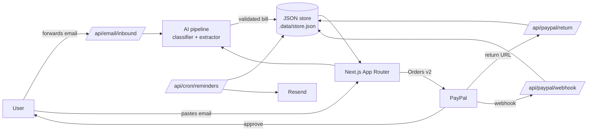

# Deadline Bill Guard

Track recurring bills, catch renewals before they hit, and stop paying for things you forgot about.

Deadline Bill Guard is a Next.js app that turns forwarded bill emails into structured, payable
bills. An AI pipeline extracts the merchant, amount, currency, due date and invoice number, the app
schedules reminders before the deadline, and PayPal handles the payment end to end — order
creation, buyer approval, capture, and verified webhook reconciliation.

**Built for the "Build What's Next with PayPal and AI" hackathon.**

[](LICENSE)

> Demo video: _link added before submission_ · Hosted demo: _link added before submission_

## The problem

People do not miss bills because they are careless. Bills arrive as email, get buried, and the
late fee is the notification. Meanwhile subscriptions renew silently. Deadline Bill Guard treats
the inbox you already use as the source of truth: no bank credentials, no screen scraping, no
spreadsheet.

## What it does

- **Email-to-bill ingestion** — forward an email to a per-user inbound address (or paste it in the
  app); the same pipeline runs for both.
- **Two-stage AI extraction** — a classifier decides whether the message is a bill, then an
  extractor returns structured fields. Zod validates the response, a deterministic parser
  cross-checks it, and a confidence score decides whether to auto-create or ask a human.
- **Reminder ladder** — four reminders per bill (H-7, H-3, H-1, H-0), delivered by a cron endpoint
  through Resend.
- **PayPal checkout** — Orders v2 create + capture, buyer return URL, webhook signature
  verification, and a per-bill PayPal audit trail.
- **Subscription radar** — recurring merchants are grouped so unused plans become a yearly number.
- **CSV export** — download every bill in one click.
- **Demo mode** — with no credentials the app still runs end to end using simulated PayPal ids and
  a deterministic AI fallback.

Supported currencies: USD, EUR, GBP, IDR, SGD, INR, PHP, AUD, CAD, MYR, THB, BRL, MXN.

## How the AI is used

`src/lib/ai/` implements a deliberately boring, auditable pipeline:

```text
forwarded email
      │
      ▼
 sanitize + truncate
      │
      ▼
 ┌─────────────────────┐      not a bill
 │ classifier (LLM)    ├──────────────────► ignored (logged)
 └─────────┬───────────┘
           │ is_bill
           ▼
 ┌─────────────────────┐
 │ extractor (LLM)     │  merchant, amount_cents, currency,
 └─────────┬───────────┘  due_date, invoice_id, category, confidence
           │
           ▼
 ┌─────────────────────┐
 │ Zod validation      │  reject malformed JSON / out-of-range values
 ├─────────────────────┤
 │ guardrails          │  amount bounds, date window, currency whitelist
 ├─────────────────────┤
 │ heuristic crosscheck│  deterministic regex/date parser as a second opinion
 └─────────┬───────────┘
           │
     confidence >= 0.6 ?
      yes ──► create bill + reminders
       no ──► human review queue
```

- **Primary provider:** Groq (`llama-3.3-70b-versatile`), JSON mode.
- **Fallback provider:** Google Gemini (`gemini-2.0-flash`).
- **No key:** the heuristic parser runs alone, so the demo never relies on a paid API.
- Every ingest stores the method, provider, model, latency, confidence and signals for audit.

## How PayPal is used

`src/lib/paypal.ts` and the routes under `src/app/api/paypal/` implement the full Orders v2 flow:

| Step | Implementation |
| --- | --- |
| Authenticate | OAuth 2.0 client credentials, token cached in memory |
| Create order | `POST /v2/checkout/orders` with `reference_id` and `custom_id` set to the bill id |
| Approve | Buyer is redirected to PayPal's `approve` link |
| Capture | `POST /v2/checkout/orders/{id}/capture` on the return URL |
| Webhook | `POST /v2/notifications/verify-webhook-signature`, then reconcile `PAYMENT.CAPTURE.COMPLETED` |
| Audit | Every `ORDER.CREATED`, capture and webhook is shown in the bill's **PayPal activity** card |

Without credentials the same code paths return simulated `SIM-` / `CAP-SIM-` ids and the UI says
so explicitly. See [`docs/PAYPAL_SANDBOX.md`](docs/PAYPAL_SANDBOX.md) for the real sandbox setup.

## Architecture



## Tech stack

| Area | Choice |
| --- | --- |
| Framework | Next.js 16 (App Router) |
| Language | TypeScript |
| UI | React 19, Tailwind CSS v4, shadcn-style components on Radix primitives |
| Icons / motion | `lucide-react`, `tw-animate-css` |
| Charts | Recharts |
| Dates | `date-fns`, `react-day-picker` |
| Validation | Zod |
| AI | Groq (primary), Google Gemini (fallback), deterministic heuristics |
| Payments | PayPal Orders v2 + Webhooks |
| Email | Resend |
| Storage | File-backed JSON store in `.data/` (no external database required) |

> This project pins Next.js 16.4.3. That release line has breaking changes versus older App Router
> versions — check `node_modules/next/dist/docs/` before changing routing or config code.

## Getting started

**Prerequisites:** Node.js 20+ and npm.

```bash
# 1. Install dependencies
npm install

# 2. Create your local env file
cp .env.example .env.local   # Windows PowerShell: Copy-Item .env.example .env.local

# 3. Start the dev server
npm run dev
```

Open <http://localhost:3000> and click **Open the demo**. Nothing is required to run locally:
email is logged instead of sent, PayPal runs in simulated mode, the AI pipeline falls back to
heuristics, and data is written to `.data/`.

### Judge quickstart (2 minutes)

1. `npm install && npm run dev`
2. Landing page → **Open the demo**
3. **Inbox** → run any sample email → open the created bill
4. **Pay with PayPal** → approve (simulated, no login) → bill marked paid
5. Open the **PayPal activity** card on the bill
6. **Subscriptions** → flag a plan as unused → see the yearly total
7. **Settings** → **Download CSV**

## Environment variables

Copy `.env.example` to `.env.local`. Nothing is required for local development.

| Variable | Default | Purpose |
| --- | --- | --- |
| `AUTH_SECRET` | dev fallback | Session signing secret. Generate with `openssl rand -base64 32`. **Required in production.** |
| `NEXT_PUBLIC_APP_URL` | `http://localhost:3000` | Public base URL used in links, PayPal return URLs and emails. |
| `NODE_ENV` | `development` | Standard Node environment flag. |
| `VERCEL_URL` | — | Injected by Vercel automatically; leave unset locally. |
| `CRON_SECRET` | empty | Shared secret for `/api/cron/reminders`. Empty leaves the endpoint open (fine for local use). |
| `DBG_DATA_DIR` | `./.data` | Directory for the file-backed JSON store. Point at a persistent volume in production. |
| `GROQ_API_KEY` | empty | Groq API key for the classifier/extractor. |
| `GROQ_MODEL` | `llama-3.3-70b-versatile` | Groq model id. |
| `GEMINI_API_KEY` | empty | Google Gemini API key (fallback provider). |
| `GEMINI_MODEL` | `gemini-2.0-flash` | Gemini model id. |
| `RESEND_API_KEY` | empty | Resend API key. Without it, reminder emails are logged and suppressed for `@billguard.app` test addresses. |
| `REMINDER_FROM` | `Bill Guard <reminders@billguard.app>` | From address for reminder emails. |
| `PAYPAL_CLIENT_ID` | empty | PayPal app client id. |
| `PAYPAL_CLIENT_SECRET` | empty | PayPal app secret. |
| `PAYPAL_MODE` | `sandbox` | `live` for production; anything else uses sandbox. |
| `PAYPAL_MERCHANT_EMAIL` | `you@billguard.app` | Merchant email used as the order payee. |
| `PAYPAL_WEBHOOK_ID` | empty | Webhook id used to verify signatures on `/api/paypal/webhook`. |
| `INBOUND_EMAIL_SECRET` | empty | Optional shared secret for `/api/email/inbound`. Set it yourself if you expose the endpoint publicly. |

Without PayPal credentials the app runs in simulated mode and returns mock `SIM-` / `CAP-SIM-`
order ids instead of contacting PayPal.

## Tools used

| Tool | Used for |
| --- | --- |
| PayPal Orders v2 API | Create orders, redirect buyers, capture payments |
| PayPal Webhooks | Signature-verified `PAYMENT.CAPTURE.COMPLETED` reconciliation |
| Groq + Llama 3.3 70B | Primary bill classifier and field extractor (JSON mode) |
| Google Gemini 2.0 Flash | Fallback LLM provider |
| Zod | Runtime validation of AI output |
| Deterministic heuristics | Offline fallback and cross-check for AI output |
| Resend | Reminder email delivery |
| Next.js 16, React 19, Tailwind v4, Radix | Application + UI |
| Recharts | Dashboard charts |

## Scripts

| Script | Command | Purpose |
| --- | --- | --- |
| `npm run dev` | `next dev` | Start the development server |
| `npm run build` | `next build` | Production build |
| `npm run start` | `next start` | Serve the production build |
| `npm run lint` | `eslint` | Lint the codebase |
| `npm run typecheck` | `tsc --noEmit` | Type-check without emitting |
| `npm run typegen` | `next typegen` | Generate Next.js route types |

## API routes

| Method | Route | Auth | Description |
| --- | --- | --- | --- |
| `GET` | `/api/bills/export` | Session | Stream all of the signed-in user's bills as CSV. |
| `GET`, `POST` | `/api/cron/reminders` | `CRON_SECRET` (when set) | Run the reminder job and return a summary. |
| `POST` | `/api/email/inbound` | `INBOUND_EMAIL_SECRET` (when set) | Accept a forwarded email (JSON or form data) and turn it into a bill. |
| `GET` | `/api/paypal/return` | Session | PayPal return URL: captures the order and marks the bill paid. |
| `POST` | `/api/paypal/webhook` | PayPal signature verification | Handle `PAYMENT.CAPTURE.COMPLETED` events. |

`/api/cron/reminders` accepts the secret as `?secret=...` or an `Authorization: Bearer ...` header.
`/api/email/inbound` accepts it as an `x-inbound-secret` header or a Bearer token.

## Project structure

```text
src/
├─ app/
│  ├─ page.tsx                 # Landing page
│  ├─ login/                   # Sign-in / demo entry
│  ├─ app/                     # Authenticated area
│  │  ├─ page.tsx              # Dashboard
│  │  ├─ bills/                # List, new, detail, edit
│  │  ├─ subscriptions/        # Recurring subscriptions
│  │  ├─ inbox/                # Forwarded-email ingestion
│  │  ├─ checkout/[orderId]/   # PayPal checkout
│  │  └─ settings/             # Account + integrations + export
│  └─ api/                     # Route handlers
├─ components/                 # App components + ui/ primitives
├─ hooks/                      # Client hooks
├─ lib/
│  ├─ ai/                      # Pipeline, provider, heuristics, prompts
│  ├─ db/store.ts              # File-backed JSON store
│  ├─ actions/                 # Server actions
│  ├─ session.ts               # Session/AUTH_SECRET handling
│  ├─ email.ts, reminders.ts   # Resend integration + reminder job
│  ├─ paypal.ts                # Orders, capture, webhook verification
│  ├─ ingest.ts                # Inbound email parsing/ingestion
│  └─ types.ts                 # Domain types
└─ proxy.ts                    # Request proxy

docs/
├─ DEMO_SCRIPT.md              # Shot list for the under-3-minute video
└─ PAYPAL_SANDBOX.md           # Real sandbox + webhook walkthrough
```

Runtime data lives in `.data/` by default and is git-ignored.

## Deployment

The app needs a **persistent filesystem** for `.data/store.json`. Vercel's serverless filesystem
is ephemeral, so use Docker on a host with a volume (Render, Railway, Fly.io, a VPS) or point
`DBG_DATA_DIR` at a mounted disk.

### Docker

```bash
docker build -t deadline-bill-guard .
docker run -p 3000:3000 \
  -e AUTH_SECRET="$(openssl rand -base64 32)" \
  -e NEXT_PUBLIC_APP_URL="http://localhost:3000" \
  -e DBG_DATA_DIR=/data \
  -v bill-guard-data:/data \
  deadline-bill-guard
```

### Render

`render.yaml` defines a Docker web service with a 1 GB disk mounted at `/data`. Update
`NEXT_PUBLIC_APP_URL` to the deployed URL after the first deploy.

### Production checklist

1. Set `AUTH_SECRET` and `NEXT_PUBLIC_APP_URL` to production values.
2. Mount a persistent volume at `DBG_DATA_DIR` (or use a managed database).
3. **Reminders:** schedule a request to `https://<your-domain>/api/cron/reminders` and set
   `CRON_SECRET`.
4. **PayPal:** set `PAYPAL_MODE=live`, add the live client id/secret and webhook id, then register
   `https://<your-domain>/api/paypal/webhook` in the PayPal developer dashboard.
5. **Email:** set `RESEND_API_KEY` and a verified `REMINDER_FROM` sender; set
   `INBOUND_EMAIL_SECRET` before pointing a mail provider at `/api/email/inbound`.
6. **AI:** set `GROQ_API_KEY` (and optionally `GEMINI_API_KEY`).

## Security notes

- Sessions are signed with `AUTH_SECRET`; cookies are `httpOnly`, `sameSite=lax`, and `secure` in
  production.
- PayPal webhooks are verified server-side before any bill is mutated.
- AI output is never trusted blindly: Zod validation, whitelists and a human review queue gate bill
  creation.
- `.env*`, `.data/` and local debug tokens are git-ignored. Never commit credentials.

## License

[MIT](LICENSE) © 2026 Dika Aff
